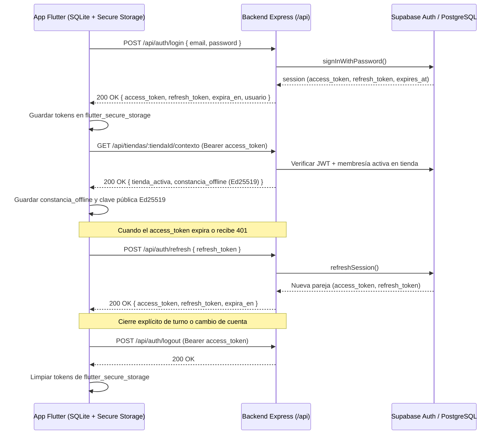

# Matriz de Permisos, Ciclo de Sesión y Constancia Offline (Sprint 2)

Este documento define el modelo de identidad, ciclo de vida de sesión, control de acceso basado en roles por tienda (RBAC multi-tienda) y validación criptográfica de vigencia sin conexión para el sistema POS de misceláneas y tiendas de abarrotes (**Node.js + Express 5 + Supabase PostgreSQL + Flutter Offline-First**).

---

## 1. Ciclo de Vida de Sesión y Tokens

La autenticación se apoya en **Supabase Auth** (JWT de corta duración + *Refresh Token* de un solo uso con rotación) expuesta a través de las rutas `/api/auth/*` del backend Express.

### Flujo operativo de sesión



### Rutas de autenticación disponibles

| Método y Ruta | Autenticación | Propósito | Respuestas esperadas |
| :--- | :--- | :--- | :--- |
| `POST /api/auth/registro` | Pública | Crear una nueva cuenta de usuario con correo y contraseña. | `201` / `200` cuenta creada, `400` datos inválidos, `409` correo ya registrado |
| `POST /api/auth/login` | Pública | Iniciar sesión y obtener `access_token` y `refresh_token`. | `200` sesión iniciada, `400` faltan campos, `401` credenciales inválidas |
| `POST /api/auth/refresh` | Pública (requiere `refresh_token`) | Renovar silenciosamente la sesión rotando tokens. | `200` tokens renovados, `400` sin `refresh_token`, `401` token inválido o vencido |
| `POST /api/auth/logout` | `Bearer <access_token>` | Cerrar la sesión activa del usuario. | `200` sesión cerrada, `401` sin token válido |
| `GET /api/auth/me` | `Bearer <access_token>` | Consultar el perfil básico (`id`, `email`) del usuario autenticado. | `200` perfil actual, `401` token inválido o expirado |
| `GET /api/auth/clave-publica-offline` | Pública | Obtener la clave pública **Ed25519** (`spki-der-base64`) para verificar constancias offline en el cliente. | `200` `{ algoritmo: 'Ed25519', formato: 'spki-der-base64', public_key_b64 }` |

### Diferencia estricta entre `401 Unauthorized` y `403 Forbidden`

El cliente móvil Flutter debe reaccionar de forma distinta ante cada código de estado:

- **`401 Unauthorized` (Problema de identidad / sesión):**
  - **Causa:** No se envió cabecera `Authorization: Bearer <token>`, el `access_token` caducó, fue revocado o el `refresh_token` ya no es válido.
  - **Acción en Flutter:** Intentar una sola vez `POST /api/auth/refresh`. Si la renovación devuelve `200`, reintentar la petición original con el nuevo `access_token`. Si el `refresh` también responde `401`, solicitar al usuario que vuelva a ingresar su contraseña **sin borrar jamás la base de datos SQLite local ni la cola de ventas pendientes de sincronización**.
- **`403 Forbidden` (Problema de autorización / permisos en la tienda):**
  - **Causa:** La identidad del usuario **es válida**, pero:
    1. No tiene membresía en la tienda indicada (`X-Tienda-Id` o `:tiendaId`).
    2. Su membresía en esa tienda fue puesta en estado `suspendido`.
    3. La tienda se encuentra en estado `suspendida`.
    4. Su rol actual (`cajero` o `encargado`) no posee el permiso requerido para ejecutar la operación (por ejemplo, un cajero intentando modificar `precio_centavos` o listar miembros).
  - **Acción en Flutter:** **No** ejecutar `refresh` ni cerrar la sesión global. Mostrar mensaje claro de operación restringida y, si aplica, actualizar el contexto de la tienda (`GET /api/tiendas` o `GET /api/tiendas/:tiendaId/contexto`) para reflejar cambios de rol o suspensión.

### Almacenamiento seguro en Flutter (`flutter_secure_storage`)

En dispositivos Android/iOS de mostrador:

1. **Nunca almacenar tokens en `SharedPreferences`, archivos planos ni logs de consola.**
2. Guardar en `flutter_secure_storage` (respaldado por *Android Keystore* / *EncryptedSharedPreferences* e *iOS Keychain*):
   - `auth.access_token`
   - `auth.refresh_token`
   - `offline.public_key_b64`
   - `offline.constancia_tienda_<tiendaId>` (último token Ed25519 recibido al validar contexto con internet)
3. Al ejecutar `logout` en un dispositivo compartido, eliminar `auth.access_token`, `auth.refresh_token` y la constancia del usuario saliente solo después de verificar si existen operaciones locales pendientes de sincronizar (advirtiendo en pantalla antes de desvincular si hay ventas en cola).

---

## 2. Constancia Criptográfica Offline (`Ed25519`) y Grace Period

Para operar sin internet durante días en zonas con conectividad intermitente sin permitir que se falsifique la suscripción localmente, el backend emite una **constancia firmada asimétricamente con Ed25519** cada vez que la app consulta `GET /api/tiendas/:tiendaId/contexto`.

### Por qué firma asimétrica Ed25519

- **Clave privada (`OFFLINE_LICENSE_PRIVATE_KEY_B64` / `OFFLINE_LICENSE_PUBLIC_KEY_B64`):** Reside exclusivamente en el servidor backend (PKCS8/SPKI DER en Base64, o par efímero en desarrollo local). Nadie fuera del servidor puede firmar ni extender una constancia.
- **Clave pública (`GET /api/auth/clave-publica-offline` -> `public_key_b64`):** Se almacena en `flutter_secure_storage` en la app Flutter. Permite verificar sin conexión y en menos de 1 ms que la constancia no fue modificada ni un solo bit, incluso en teléfonos con *root*.

### Formato y estructura del `payload`

El `token` tiene el formato compacto `<payload_json_base64url>.<firma_ed25519_base64url>`. Al decodificar el `payload` se obtiene:

| Campo | Tipo | Descripción |
| :--- | :--- | :--- |
| `v` | `number` | Versión del esquema de constancia offline (actualmente `1`). |
| `tienda_id` | `string (UUID)` | Identificador único de la tienda autorizada. |
| `usuario_id` | `string (UUID)` | Identificador del usuario autenticado al que se emitió la constancia. |
| `rol` | `string` | Rol vigente del usuario en esa tienda (`propietario`, `encargado` o `cajero`). |
| `estado_tienda` | `string` | Estado operativo de la tienda (`activa` o `suspendida`). |
| `estado_suscripcion` | `string` | Estado comercial (`prueba`, `activa`, `vencida`, `cancelada`, `suspendida`). |
| `permite_nuevas_ventas` | `boolean` | `true` al momento de emisión solo si la tienda está `activa`, la suscripción es `prueba` o `activa` y no ha expirado. |
| `permite_consulta_fiados_inventario` | `boolean` | **Siempre `true`**. Garantiza acceso permanente de lectura a cuentas por cobrar e inventario. |
| `emitido_en` | `string (ISO-8601)` | Marca de tiempo exacta del servidor cuando se firmó la constancia. |
| `ventana_offline_hasta` | `string (ISO-8601)` | Límite máximo para operar sin internet (por defecto **96 horas** desde `emitido_en`, acotado por `licencia_expira_en`). |
| `licencia_expira_en` | `string (ISO-8601)` | Fecha de vencimiento de la suscripción o periodo de prueba de la tienda. |

### Reglas de verificación local (`verificarConstanciaOffline`)

Al abrir caja o registrar una venta sin conexión, el cliente evalúa el token junto con la hora actual del dispositivo (`fechaActual`) y la marca de tiempo más reciente registrada en SQLite local (`ultimaFechaEventoLocal`, correspondiente a la última venta, abono de fiado o movimiento de inventario):

1. **Integridad criptográfica (`FIRMA_O_FORMATO_INVALIDO`):**
   - Si el formato no tiene dos segmentos Base64URL válidos o la firma **Ed25519** no coincide con el `payload` y la clave pública oficial:
   - `valida: false`, `ventana_vigente: false`, `permite_nuevas_ventas: false`.
2. **Protección contra reloj atrasado (`RELOJ_ATRASADO`):**
   - Si el reloj del teléfono fue atrasado manualmente para intentar burlar el vencimiento —detectado cuando `fechaActual` es anterior a `emitido_en` (más allá de una breve tolerancia por deriva NTP) **o** cuando `fechaActual` es anterior a `ultimaFechaEventoLocal` registrada en SQLite—:
   - `valida: false`, `ventana_vigente: false`, `motivo: 'RELOJ_ATRASADO'`, `permite_nuevas_ventas: false`, `permite_consulta_fiados_inventario: true`.
   - La app solicita corregir la fecha/hora automática del teléfono o conectarse brevemente a internet para renovar la constancia.
3. **Grace Period de 96 h o suscripción vencida (`VENTANA_OFFLINE_O_LICENCIA_VENCIDA`):**
   - Por defecto cada tienda cuenta con `ventana_offline_horas = 96` (4 días continuos sin conexión). Cada vez que el teléfono recupera internet y sincroniza contexto, la ventana de 96 horas se renueva automáticamente mientras la suscripción siga vigente.
   - Si se supera `ventana_offline_hasta`, se supera `licencia_expira_en`, o `estado_suscripcion` es `vencida` / `cancelada` / `suspendida`:
   - `valida: true`, `ventana_vigente: false`, `motivo: 'VENTANA_OFFLINE_O_LICENCIA_VENCIDA'`, `permite_nuevas_ventas: false`, `permite_consulta_fiados_inventario: true`.
4. **Vigencia plena (`OK`):**
   - Firma válida, reloj consistente y dentro de la ventana offline y de licencia:
   - `valida: true`, `ventana_vigente: true`, `motivo: 'OK'`, `permite_nuevas_ventas: true`, `permite_consulta_fiados_inventario: true`.

> **Regla comercial inquebrantable:** El tendero es dueño de su información operativa. Aun cuando la suscripción o la ventana offline de 96 horas hayan vencido (`permite_nuevas_ventas = false`), **jamás se bloquea la consulta de la libreta de fiados ni del inventario** (`permite_consulta_fiados_inventario = true`), permitiéndole cobrar deudas pendientes y revisar su mercancía en cualquier circunstancia.

---

## 3. Matriz de Permisos por Rol y Doble Validación

Los permisos se asignan **por membresía de tienda** (`public.miembros_tienda`), por lo que una misma cuenta puede ser `propietario` en su tienda principal y `encargado` o `cajero` en otra sucursal.

La seguridad aplica **defensa en profundidad en dos capas independientes**:
1. **Capa API Express (`src/config/permisos.js` + middleware `verificarContextoTienda`):** Valida el JWT, confirma que la tienda y la membresía estén activas y verifica el permiso granular antes de ejecutar la lógica del endpoint.
2. **Capa PostgreSQL / Supabase (`migrations/001` y `002`):** Aplica *Row Level Security* (RLS), privilegios de columna (`GRANT UPDATE (nombre)`) y funciones RPC `SECURITY DEFINER` con `SET search_path = ''` que revalidan `auth.uid()` y el rol activo. Incluso si un cliente llamara directamente a PostgREST saltándose Express, las mismas restricciones se cumplen en la base de datos.

### Tabla completa de permisos (`MATRIZ_PERMISOS`)

| Permiso (`src/config/permisos.js`) | `propietario` | `encargado` | `cajero` | Ruta HTTP Express | Respaldo en PostgreSQL (RLS / Grants / RPC) |
| :--- | :---: | :---: | :---: | :--- | :--- |
| `tienda:leer` | Sí | Sí | Sí | `GET /api/tiendas`<br>`GET /api/tiendas/:tiendaId/contexto` | Política `tiendas_select_miembro_activo` (`es_miembro_activo_tienda(id)`) |
| `tienda:editar` | Sí | **No** | **No** | `PATCH /api/tiendas/:tiendaId` | Política `tiendas_update_propietario` + **`GRANT UPDATE (nombre)`** (bloquea edición de `licencia_expira_en`, `estado_suscripcion`, `estado` y `ventana_offline_horas`) |
| `miembros:leer` | Sí | Sí | **No** | `GET /api/tiendas/:tiendaId/miembros` | RPC `public.listar_miembros_tienda(p_tienda_id)` + política `miembros_select_propios_o_gestion` |
| `miembros:agregar` | Sí (cualquier rol) | Sí (**solo `cajero`**) | **No** | `POST /api/tiendas/:tiendaId/miembros` | Sin `GRANT INSERT` directo en tabla; alta exclusiva vía RPC `public.agregar_miembro_tienda` que exige `v_rol_limpio = 'cajero'` cuando el actor es `encargado` |
| `miembros:cambiar_rol` | Sí (a terceros) | **No** | **No** | `PATCH /api/tiendas/:tiendaId/miembros/:miembroId` | Sin `GRANT UPDATE` directo en tabla; RPC `public.actualizar_miembro_tienda` exige `v_rol_actor = 'propietario'`, prohíbe auto-edición y garantiza `>= 1` propietario activo |
| `miembros:cambiar_estado` | Sí (a terceros) | Sí (**solo a `cajero`**) | **No** | `PATCH /api/tiendas/:tiendaId/miembros/:miembroId` | RPC `public.actualizar_miembro_tienda` valida que `encargado` solo suspenda/reactive a miembros con rol `cajero` y prohíbe auto-suspensión |
| `productos:leer` | Sí | Sí | Sí | `GET /api/productos` (`X-Tienda-Id`)<br>`GET /api/tiendas/:tiendaId/productos` | Política `productos_select_miembro_activo` (`es_miembro_activo_tienda(tienda_id)`) |
| `productos:crear` | Sí | Sí | **No** | `POST /api/productos` (`X-Tienda-Id`)<br>`POST /api/tiendas/:tiendaId/productos` | Política `productos_insert_roles_autorizados` (`rol IN ('propietario', 'encargado')`) |
| `productos:editar` | Sí | Sí | **No** | `PATCH /api/productos/:productoId` | Política `productos_update_roles_autorizados` (`rol IN ('propietario', 'encargado')`) |
| `productos:cambiar_precio` | Sí | Sí | **No** | `PATCH /api/productos/:productoId` (`precio_centavos`) | Política `productos_update_roles_autorizados` + validación entera en centavos (`>= 0`) |

### Reglas e invariantes adicionales de seguridad

- **Prohibición de auto-degradación o auto-suspensión:** Ningún usuario (incluido el `propietario`) puede cambiar su propio rol ni suspender su propia membresía (`403 Forbidden` en Express y código SQL `42501` en `actualizar_miembro_tienda`).
- **Invariante de propietario activo:** La base de datos rechaza transaccionalmente cualquier cambio que deje a una tienda con `0` miembros con `rol = 'propietario'` y `estado = 'activo'`.
- **Suspensión inmediata:** Cuando una membresía pasa a `estado = 'suspendido'`, `public.rol_activo_en_tienda(tienda_id)` devuelve `NULL` al instante. Aunque el excajero conserve un `access_token` que aún no caduca en minutos restantes, tanto Express (`403`) como PostgreSQL RLS (`0` filas visibles / escrituras denegadas) bloquean cualquier acceso a la tienda de forma inmediata.
- **Protección antifraude de columnas de licencia:** En `002_identidad_permisos_y_membresias.sql` se revocó `UPDATE` general sobre `public.tiendas` y se otorgó únicamente `GRANT UPDATE (nombre) ON TABLE public.tiendas TO authenticated`. Un propietario no puede modificar `licencia_expira_en`, `estado_suscripcion` ni `ventana_offline_horas` ni siquiera invocando directamente la API REST de Supabase con su propio JWT.

---

## 4. Ejemplos Reproducibles en PowerShell (`Invoke-RestMethod`)

Asegúrate de tener el servidor corriendo localmente (`npm run dev` en `http://localhost:3000`).

### 4.1 Iniciar sesión y guardar tokens en variables de sesión

```powershell
$baseUrl = "http://localhost:3000"

$loginBody = @{
    email    = "propietario@ejemplo.com"
    password = "TuPasswordSeguro123!"
} | ConvertTo-Json

$sesion = Invoke-RestMethod -Method Post `
    -Uri "$baseUrl/api/auth/login" `
    -ContentType "application/json" `
    -Body $loginBody

$token        = $sesion.access_token
$refreshToken = $sesion.refresh_token
$headersAuth  = @{ Authorization = "Bearer $token" }

$sesion.usuario
```

### 4.2 Renovar sesión con `refresh_token`

```powershell
$refreshBody = @{
    refresh_token = $refreshToken
} | ConvertTo-Json

$nuevaSesion = Invoke-RestMethod -Method Post `
    -Uri "$baseUrl/api/auth/refresh" `
    -ContentType "application/json" `
    -Body $refreshBody

$token        = $nuevaSesion.access_token
$refreshToken = $nuevaSesion.refresh_token
$headersAuth  = @{ Authorization = "Bearer $token" }
```

### 4.3 Consultar tiendas, contexto activo y constancia offline Ed25519

```powershell
# 1. Obtener clave pública Ed25519 (cacheable en Flutter)
$clavePublica = Invoke-RestMethod -Method Get -Uri "$baseUrl/api/auth/clave-publica-offline"
$clavePublica.algoritmo

# 2. Listar tiendas activas del usuario y seleccionar Tienda-Demo
$misTiendas = Invoke-RestMethod -Method Get -Uri "$baseUrl/api/tiendas" -Headers $headersAuth
$tiendaId = ($misTiendas.tiendas | Where-Object { $_.nombre -eq "Tienda-Demo" } | Select-Object -First 1).id

# 3. Validar contexto y recibir la constancia criptográfica offline (96 h de ventana)
$contexto = Invoke-RestMethod -Method Get `
    -Uri "$baseUrl/api/tiendas/$tiendaId/contexto" `
    -Headers $headersAuth

$contexto.tienda_activa
$contexto.constancia_offline.payload
```

### 4.4 Vincular un cajero a la tienda (idempotente)

```powershell
$nuevoCajeroBody = @{
    email = "cajero1@ejemplo.com"
    rol   = "cajero"
} | ConvertTo-Json

$altaMiembro = Invoke-RestMethod -Method Post `
    -Uri "$baseUrl/api/tiendas/$tiendaId/miembros" `
    -Headers $headersAuth `
    -ContentType "application/json" `
    -Body $nuevoCajeroBody

$miembroId = $altaMiembro.miembro.id
$altaMiembro
```

### 4.5 Promover a encargado y suspender membresía

```powershell
# Cambiar rol de cajero -> encargado (solo permitido al propietario)
$cambioRolBody = @{
    rol = "encargado"
} | ConvertTo-Json

Invoke-RestMethod -Method Patch `
    -Uri "$baseUrl/api/tiendas/$tiendaId/miembros/$miembroId" `
    -Headers $headersAuth `
    -ContentType "application/json" `
    -Body $cambioRolBody

# Suspender acceso inmediatamente (revoca acceso en Express y PostgreSQL RLS al instante)
$suspenderBody = @{
    estado = "suspendido"
} | ConvertTo-Json

Invoke-RestMethod -Method Patch `
    -Uri "$baseUrl/api/tiendas/$tiendaId/miembros/$miembroId" `
    -Headers $headersAuth `
    -ContentType "application/json" `
    -Body $suspenderBody
```

### 4.6 Actualizar precio de un producto en centavos

```powershell
$headersTienda = @{
    Authorization = "Bearer $token"
    "X-Tienda-Id" = $tiendaId
}

# Consultar productos actuales de la tienda
$catalogo = Invoke-RestMethod -Method Get `
    -Uri "$baseUrl/api/productos" `
    -Headers $headersTienda

$producto = $catalogo.productos | Select-Object -First 1

# Actualizar precio_centavos (ej. $25.50 MXN = 2550 centavos; permitido a propietario y encargado, 403 para cajero)
$precioBody = @{
    precio_centavos = 2550
} | ConvertTo-Json

$actualizado = Invoke-RestMethod -Method Patch `
    -Uri "$baseUrl/api/productos/$($producto.id)" `
    -Headers $headersTienda `
    -ContentType "application/json" `
    -Body $precioBody

$actualizado.producto
```

### 4.7 Ejecutar la verificación automatizada del Sprint 2

```powershell
# Solo pruebas locales deterministas (matriz de permisos, Ed25519 offline, validaciones HTTP sin credenciales):
node scripts/verificar_sprint2.js

# Suite completa incluyendo integración real con Supabase, RLS y multi-usuario:
$env:TEST_USER_EMAIL="propietario@ejemplo.com"
$env:TEST_USER_PASSWORD="TuPasswordSeguro123!"
$env:TEST_USER2_EMAIL="colaborador@ejemplo.com"
$env:TEST_USER2_PASSWORD="PasswordColaborador123!"
node scripts/verificar_sprint2.js
```
